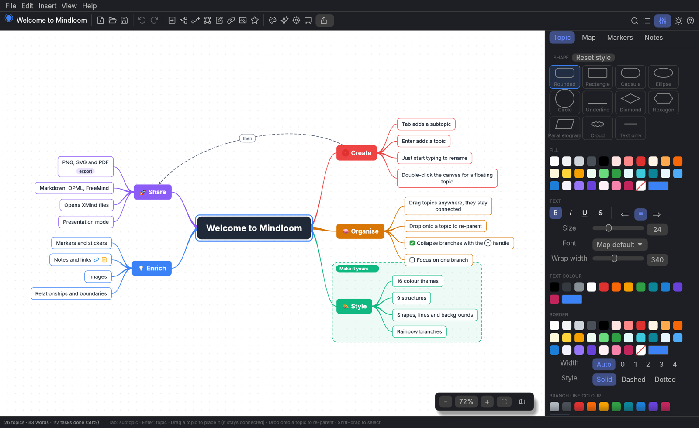
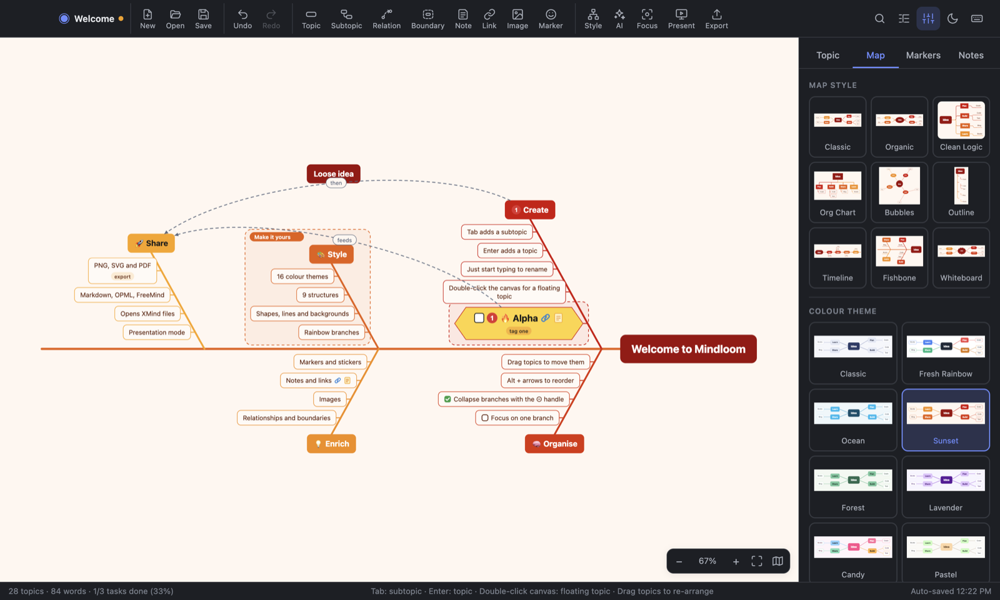
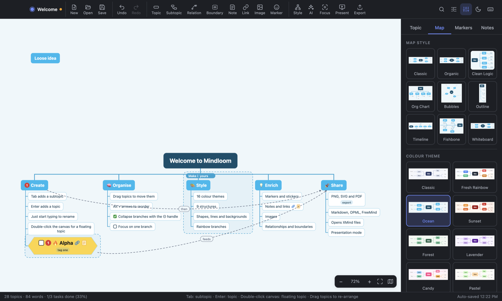
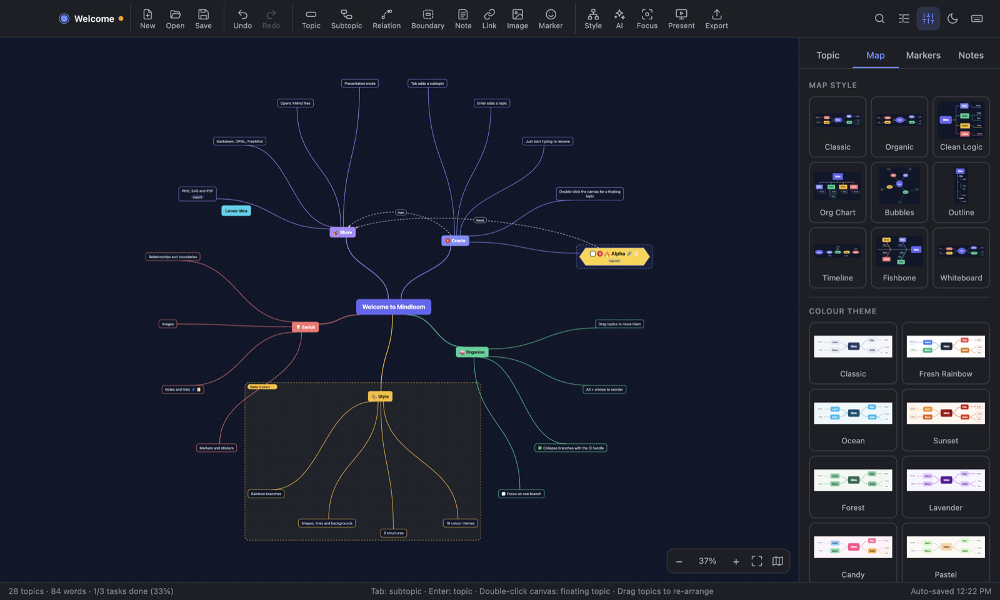
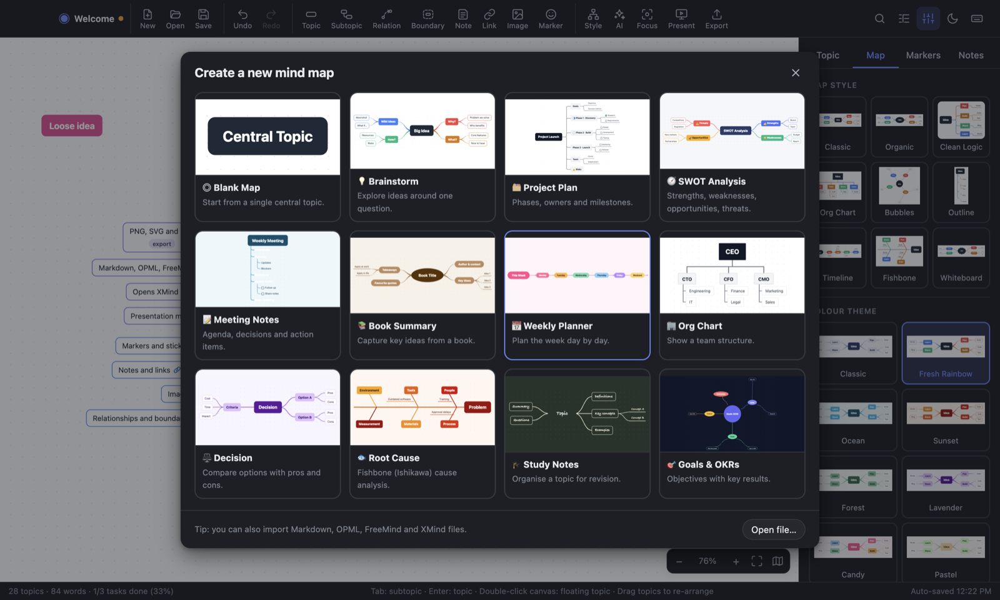

# Mindloom

A fast, friendly mind mapping app for **macOS** and **Windows**. Press <kbd>Tab</kbd> for a subtopic, <kbd>Enter</kbd> for a topic, and start typing.

Version 2 is written in Rust: a single native app of about 30 MB that starts instantly and stays smooth on maps with thousands of topics.



## Download

Get the latest installers from the [Releases page](https://github.com/imranseoxpert/mindloom/releases/latest):

| Platform | File |
| --- | --- |
| macOS 11 or later (Apple Silicon and Intel) | `Mindloom-2.0.0-mac-universal.dmg` |
| Windows 10/11 (64-bit), installer | `Mindloom-2.0.0-win-x64.exe` |
| Windows 10/11 (64-bit), no install | `Mindloom-2.0.0-win-x64-portable.zip` |

The installers are not signed with a paid Apple or Microsoft developer certificate, so each system shows a warning the first time:

- **macOS:** open the `.dmg`, drag Mindloom to Applications, then open it. If macOS blocks it, go to **System Settings → Privacy & Security** and click **Open Anyway**. Or run `xattr -cr /Applications/Mindloom.app` once in Terminal.
- **Windows:** when SmartScreen appears, click **More info → Run anyway**.

Maps made with Mindloom 1.x open unchanged in 2.0, and the other way round.

## Features

**Building maps**

- Add topics with <kbd>Tab</kbd> and <kbd>Enter</kbd>; rename by just typing; edit in place with <kbd>F2</kbd>, <kbd>Space</kbd> or a double-click
- Drag a topic anywhere: it stays connected to its parent, its subtopics move with it, and nothing else shifts. Drop it near its original spot and it snaps back
- Drop a topic onto another to re-parent it, or on a sibling's edge to reorder; drag a main topic across the centre to switch sides
- Main topics keep their side when you add or remove others, so the map never reshuffles
- Select several topics (Shift-click or Shift-drag a rectangle) and move them together; nudge with Shift+Alt+arrows
- Double-click the canvas for a floating topic; drag a relationship line to reshape its curve
- Collapse and expand branches, focus on a single branch, sort subtopics
- Copy, cut, paste and duplicate whole branches; paste any indented text as topics
- Undo and redo, crash-safe auto-save, and the last file reopens on launch
- Find across topics, notes, labels and links
- Outline panel and mini map for large maps

**Structures (9)**

Mind map, logic chart (left or right), org chart (up or down), tree/outline, timeline, fishbone and radial.

| Fishbone | Org chart | Radial, dark theme |
| --- | --- | --- |
|  |  |  |

**Styling**

- 16 colour themes, 4 of them dark, with optional rainbow branches
- 9 one-click map styles that combine structure, lines and shapes
- 11 topic shapes: rounded, rectangle, capsule, ellipse, circle, underline, diamond, hexagon, parallelogram, cloud, text only
- 5 branch line styles: curved, tapered, straight, elbow, rounded elbow
- 8 canvas backgrounds: plain, dots, grid, graph paper, ruled, crosses, diagonal, isometric
- Per-topic fill, text, border and branch colours, fonts, sizes, alignment and wrap width; copy and paste a style between topics
- Light and dark interface

**Enriching topics**

- Priority, progress, flag and star markers plus emoji stickers
- Task checkboxes with a completion count in the status bar
- Notes, hyperlinks, labels and images (paste, drop or pick a file)
- Relationship arrows with labels, and boundaries around a branch

**Files**

- Native `.mindloom` format (plain JSON)
- Import: XMind (`.xmind`), FreeMind/Freeplane (`.mm`), OPML, Markdown and indented text
- Export: PNG (optionally transparent), SVG, PDF, Markdown, OPML, FreeMind and plain text
- 12 starter templates, including brainstorm, project plan, SWOT, meeting notes, book summary, weekly planner, org chart, decision, root cause, study notes and goals



**Presenting**

Presentation mode (<kbd>F5</kbd>) walks through the map one branch at a time in full screen.

**AI assistant (optional, bring your own key)**

Generate a map from a topic, turn pasted notes into a map, or expand the selected topic with new ideas. Connect the provider you already use:

| Cloud | On your computer | Other |
| --- | --- | --- |
| Anthropic (Claude), OpenAI, Google Gemini, Mistral, Groq, DeepSeek, xAI (Grok), OpenRouter, Together AI | Ollama, LM Studio (no key needed) | Any OpenAI-compatible API address |

Keys are stored in your operating system's keychain (macOS Keychain, Windows Credential Manager) and each key is only sent to its own provider. "Load models" lists the models your key can use. The rest of the app works fully offline.

## Keyboard shortcuts

On Windows use <kbd>Ctrl</kbd> where the table says <kbd>⌘</kbd>. Press <kbd>F1</kbd> in the app for the full list.

| Action | Shortcut |
| --- | --- |
| Add subtopic / topic / parent | <kbd>Tab</kbd> / <kbd>Enter</kbd> / <kbd>⌘</kbd><kbd>Enter</kbd> |
| Edit topic | <kbd>F2</kbd>, <kbd>Space</kbd>, or just type |
| New line while editing | <kbd>Shift</kbd><kbd>Enter</kbd> |
| Delete topic | <kbd>Delete</kbd> |
| Move between topics | Arrow keys |
| Reorder / indent / outdent | <kbd>Alt</kbd> + arrow keys |
| Collapse or expand | <kbd>⌘</kbd><kbd>/</kbd> |
| Priority 1–6 | <kbd>⌘</kbd><kbd>1</kbd> … <kbd>⌘</kbd><kbd>6</kbd> |
| Link / note / relationship / boundary | <kbd>⌘</kbd><kbd>K</kbd> / <kbd>⇧⌘</kbd><kbd>M</kbd> / <kbd>⇧⌘</kbd><kbd>R</kbd> / <kbd>⇧⌘</kbd><kbd>B</kbd> |
| Nudge a topic | <kbd>Shift</kbd><kbd>Alt</kbd> + arrow keys |
| Copy / paste style | <kbd>⌥⌘</kbd><kbd>C</kbd> / <kbd>⌥⌘</kbd><kbd>V</kbd> |
| Select with a rectangle | <kbd>Shift</kbd> + drag on the canvas |
| Focus on branch | <kbd>⇧⌘</kbd><kbd>F</kbd> |
| Find | <kbd>⌘</kbd><kbd>F</kbd> |
| Zoom in / out / fit | <kbd>⌘</kbd><kbd>=</kbd> / <kbd>⌘</kbd><kbd>-</kbd> / <kbd>⌘</kbd><kbd>0</kbd> |
| Presentation | <kbd>F5</kbd> |

## Build from source

Requires the current stable [Rust](https://rustup.rs/).

```bash
git clone https://github.com/imranseoxpert/mindloom.git
cd mindloom/rust
cargo run --release -p mindloom
```

Create installers (output goes to `rust/dist/`):

```bash
rust/packaging/macos/build.sh
```

The Windows installer is built with [Inno Setup](https://jrsoftware.org/isinfo.php) from `rust/packaging/windows/mindloom.iss`; the [GitHub Actions workflow](.github/workflows/rust-release.yml) builds both on every `v2*` tag.

## Tests

```bash
cd rust
cargo test --release
MINDLOOM_SELFTEST=/tmp/mindloom-selftest cargo run --release -p mindloom
```

- `cargo test` replays 15,197 recordings of the 1.x engine (layouts of every structure and theme, the drawn map and SVG export, styles, text wrapping, every import and export format, and the editing operations) and checks the Rust engine gives the same result: positions within a millionth of a pixel, files byte for byte.
- `MINDLOOM_SELFTEST=<folder>` starts the real app, drives it with mouse and keyboard events (typing, dragging with free placement and re-parenting, undo, marquee selection, floating topics, every structure, dialogs, search, presentation, exports, saving and reopening, a 1,453-topic map), writes screenshots and `report.txt` to the folder, and quits.

## Project layout

```
rust/core/           The engine, no interface: document model, nine layouts, SVG renderer, import/export, themes, templates
rust/app/            The app (egui): canvas, interaction, panels, dialogs, files, autosave, exports, AI assistant
rust/packaging/      macOS bundle and .dmg script, Windows installer script and icon
rust/cases/          Recordings of the 1.x engine that the Rust engine is tested against (rust/record.js makes them)
src/                 Mindloom 1.x (Electron). Kept as the reference, and used by the Notes app's mind maps
```

The map is drawn by the same layout engine for the screen, the PNG/SVG/PDF exports and the theme previews, so what you export is what you see.

## Licence

[MIT](LICENSE)
