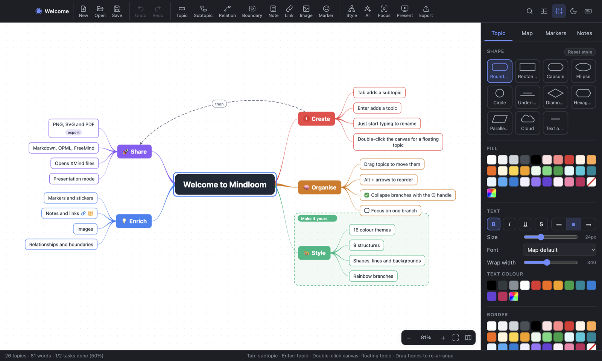
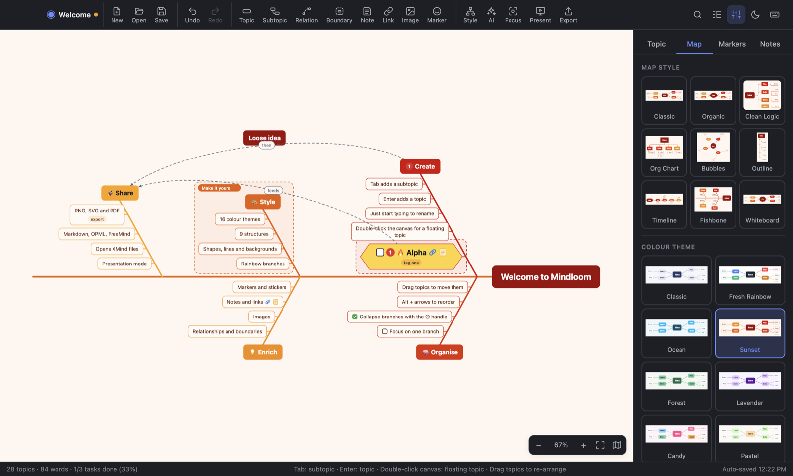
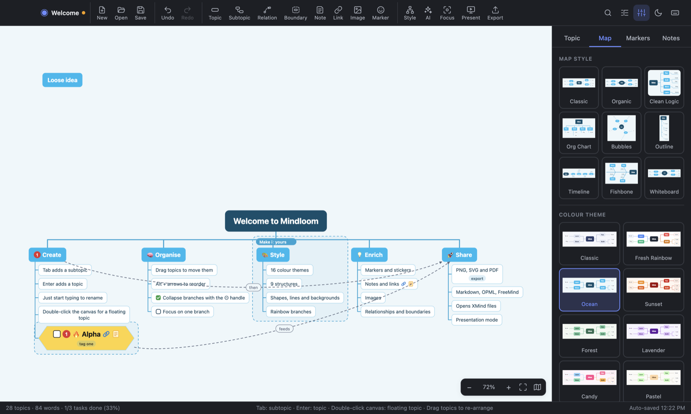
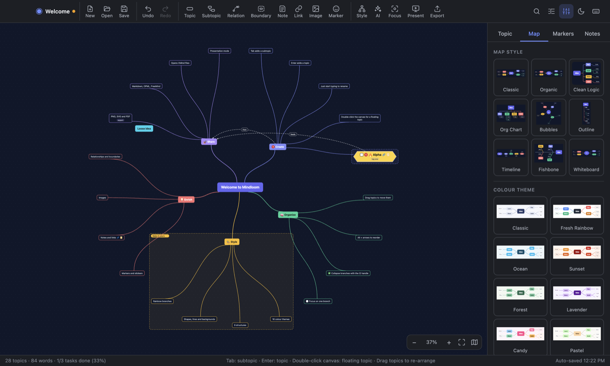
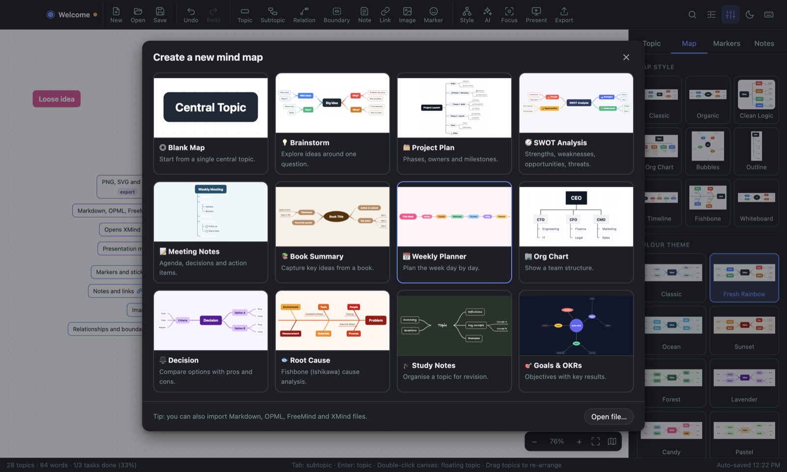

# Mindloom

A fast, friendly mind mapping app for **macOS** and **Windows**. Press <kbd>Tab</kbd> for a subtopic, <kbd>Enter</kbd> for a topic, and start typing.



## Download

Get the latest installers from the [Releases page](https://github.com/imranseoxpert/mindloom/releases/latest):

| Platform | File |
| --- | --- |
| macOS (Apple Silicon and Intel) | `Mindloom-1.0.0-mac-universal.dmg` |
| Windows 10/11 (64-bit) | `Mindloom-1.0.0-win-x64.exe` |

The installers are not signed with a paid Apple or Microsoft developer certificate, so each system shows a warning the first time:

- **macOS:** open the `.dmg`, drag Mindloom to Applications, then open it. If macOS blocks it, go to **System Settings → Privacy & Security** and click **Open Anyway**. Or run `xattr -cr /Applications/Mindloom.app` once in Terminal.
- **Windows:** when SmartScreen appears, click **More info → Run anyway**.

## Features

**Building maps**

- Add topics with <kbd>Tab</kbd> and <kbd>Enter</kbd>; rename by just typing; edit in place with <kbd>F2</kbd>, <kbd>Space</kbd> or a double-click
- Drag any topic onto another to move it, between siblings to reorder it, or onto empty canvas to make it a floating topic
- Double-click the canvas for a new floating topic
- Collapse and expand branches, focus on a single branch, sort subtopics
- Copy, cut, paste and duplicate whole branches; paste any indented text as topics
- Undo and redo, auto-save, and recovery of the last session
- Find across topics, notes, labels and links
- Outline panel and mini map for large maps

**Structures (9)**

Mind map, logic chart (left or right), org chart (up or down), tree/outline, timeline, fishbone and radial.

| Fishbone | Org chart | Radial, dark theme |
| --- | --- | --- |
|  |  |  |

**Styling**

- 16 colour themes, 4 of them dark, with optional rainbow branches
- 9 one-click map styles that combine structure, lines and shapes
- 11 topic shapes: rounded, rectangle, capsule, ellipse, circle, underline, diamond, hexagon, parallelogram, cloud, text only
- 5 branch line styles: curved, tapered, straight, elbow, rounded elbow
- 8 canvas backgrounds: plain, dots, grid, graph paper, ruled, crosses, diagonal, isometric
- Per-topic fill, text, border and branch colours, fonts, sizes, alignment and wrap width
- Light and dark interface

**Enriching topics**

- Priority, progress, flag and star markers plus emoji stickers
- Task checkboxes with a completion count in the status bar
- Notes, hyperlinks, labels and images (paste, drop or pick a file)
- Relationship arrows with labels, and boundaries around a branch

**Files**

- Native `.mindloom` format (plain JSON)
- Import: XMind (`.xmind`), FreeMind/Freeplane (`.mm`), OPML, Markdown and indented text
- Export: PNG (optionally transparent), SVG, PDF, Markdown, OPML, FreeMind and plain text
- 12 starter templates, including brainstorm, project plan, SWOT, meeting notes, book summary, weekly planner, org chart, decision, root cause, study notes and goals



**Presenting**

Presentation mode (<kbd>F5</kbd>) walks through the map one branch at a time in full screen.

**AI assistant (optional)**

Generate a whole map from a topic, or suggest subtopics for the selected topic. It uses your own [Anthropic API key](https://console.anthropic.com/), which is stored encrypted on your computer and sent only to `api.anthropic.com`. The rest of the app works fully offline.

## Keyboard shortcuts

On Windows use <kbd>Ctrl</kbd> where the table says <kbd>⌘</kbd>. Press <kbd>F1</kbd> in the app for the full list.

| Action | Shortcut |
| --- | --- |
| Add subtopic / topic / parent | <kbd>Tab</kbd> / <kbd>Enter</kbd> / <kbd>⌘</kbd><kbd>Enter</kbd> |
| Edit topic | <kbd>F2</kbd>, <kbd>Space</kbd>, or just type |
| New line while editing | <kbd>Shift</kbd><kbd>Enter</kbd> |
| Delete topic | <kbd>Delete</kbd> |
| Move between topics | Arrow keys |
| Reorder / indent / outdent | <kbd>Alt</kbd> + arrow keys |
| Collapse or expand | <kbd>⌘</kbd><kbd>/</kbd> |
| Priority 1–6 | <kbd>⌘</kbd><kbd>1</kbd> … <kbd>⌘</kbd><kbd>6</kbd> |
| Link / note / relationship / boundary | <kbd>⌘</kbd><kbd>K</kbd> / <kbd>⇧⌘</kbd><kbd>M</kbd> / <kbd>⇧⌘</kbd><kbd>R</kbd> / <kbd>⇧⌘</kbd><kbd>B</kbd> |
| Focus on branch | <kbd>⇧⌘</kbd><kbd>F</kbd> |
| Find | <kbd>⌘</kbd><kbd>F</kbd> |
| Zoom in / out / fit | <kbd>⌘</kbd><kbd>=</kbd> / <kbd>⌘</kbd><kbd>-</kbd> / <kbd>⌘</kbd><kbd>0</kbd> |
| Presentation | <kbd>F5</kbd> |

## Build from source

Requires [Node.js](https://nodejs.org/) 20 or newer.

```bash
git clone https://github.com/imranseoxpert/mindloom.git
cd mindloom
npm install
npm start
```

Create installers (output goes to `dist/`):

```bash
npm run dist:mac
npm run dist:win
```

## Tests

```bash
npm test
npm run test:app
```

- `npm test` runs the unit tests for the document model, the nine layout algorithms, the SVG renderer, theme contrast, and every import/export format.
- `npm run test:app` launches the real app and drives it with mouse and keyboard events: creating, renaming, dragging and deleting topics, every structure × theme combination, dialogs, presentation mode, PNG/SVG/PDF export, and saving and reopening files.

## Project layout

```
src/main/            Electron main process: windows, menus, file dialogs, PDF, AI
src/renderer/core/   Pure logic, no DOM: model, layout, SVG renderer, import/export, themes, templates
src/renderer/ui/     The interface: canvas interaction, panels, dialogs
test/                Unit tests and the in-app end-to-end test
examples/            Sample .mindloom files
```

The map is drawn as plain SVG by one renderer that is shared by the screen, the PNG/SVG/PDF exports and the theme previews, so what you export is what you see.

## Licence

[MIT](LICENSE)
